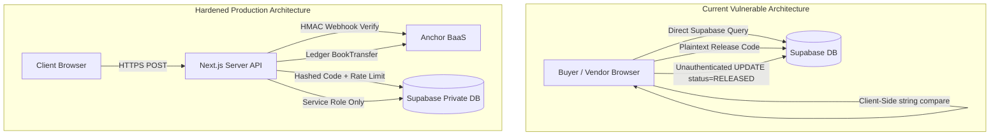

# Relyvora Nigeria (ng.relyvora.com) Go-Live Architecture & Security Audit (Phase G0)

> **Date:** November 8, 2026  
> **Auditor:** Antigravity  
> **Branch:** `go-live-prod`  
> **Target Scope:** Move `ng.relyvora.com` from simulated sandbox to real payments via Anchor BaaS.  
> **Status:** Phase G0 Complete — Read-Only Architecture Audit (No Code Changes)

---

## Executive Summary

Relyvora currently operates a **simulated escrow demonstration** on `ng.relyvora.com`. While the user experience (flow progression, fee calculation, UI states, and responsive styling) is clean and intuitive, **no real funds are currently collected, held, or disbursed in production**. 

The existing implementation relies on client-side state manipulation via Supabase anonymous queries with permissive Row Level Security (`USING (true)`), browser `localStorage` fallbacks, unhashed release codes, client-side code checks, and mock payment confirmations.

This document presents a granular, forensic audit of the current architecture, identifies all simulated components, maps required Anchor API replacements, reviews critical security vulnerabilities, audits dispute handling, and establishes a prioritized blocker register for **Phase G1, G2, and G3**.

---

## 1. End-to-End Flow As It Works Today

The current application flow is distributed across the following key files:

| Step | User Action | Current Implementation & File | Database & State Change | Mock / Real Status |
|---|---|---|---|---|
| **1. Vendor Link Creation** | Vendor inputs item name, price, and customer details on `/vendor` | [`app/(app)/vendor/page.tsx`](file:///c:/Users/osina/Relyvora/app/(app)/vendor/page.tsx) calls `createTransaction()` in [`lib/supabase.ts`](file:///c:/Users/osina/Relyvora/lib/supabase.ts) | Inserts row into `public.transactions` with `status: 'AWAITING_PAYMENT'`, or writes to browser `localStorage` (`relyvora_transactions_cache`) | **Partially Live (DB)** / No Anchor link |
| **2. Link Sharing** | Vendor copies payment URL or pre-formatted WhatsApp text | Generated in [`app/(app)/vendor/page.tsx`](file:///c:/Users/osina/Relyvora/app/(app)/vendor/page.tsx) (`/pay/[id]`) | None | **Live UI** |
| **3. Buyer Checkout** | Buyer navigates to `/pay/[id]`, views breakdown, and clicks "Pay" | [`app/(app)/pay/[id]/page.tsx`](file:///c:/Users/osina/Relyvora/app/(app)/pay/[id]/page.tsx) opens [`components/SimulatedPaymentModal.tsx`](file:///c:/Users/osina/Relyvora/components/SimulatedPaymentModal.tsx) | Fetches order via `getTransactionById()` from Supabase | **Live UI** |
| **4. Payment Confirmation** | Buyer chooses Card, Transfer, or USSD and clicks "Simulate Payment" | [`components/SimulatedPaymentModal.tsx`](file:///c:/Users/osina/Relyvora/components/SimulatedPaymentModal.tsx) simulates 1200ms delay; calls `handleConfirmPayment()` in [`app/(app)/pay/[id]/page.tsx`](file:///c:/Users/osina/Relyvora/app/(app)/pay/[id]/page.tsx) | Insecurely generates `Math.random()` 6-digit code; calls `updateTransaction()` setting `status: 'FUNDS_LOCKED'`, `release_code: randomCode`, `paid_at: now` | **100% Mocked** / No money collected |
| **5. Funds Held in Escrow** | Buyer redirected to `/order/[id]?new_payment=true` | [`app/(app)/order/[id]/page.tsx`](file:///c:/Users/osina/Relyvora/app/(app)/order/[id]/page.tsx) displays "Funds Locked in Escrow" stepper & confidential 6-digit code | Displays plaintext `transaction.release_code` directly from React state | **100% Mocked** / No FBO ledger deposit |
| **6. Order Dispatch** | Vendor marks item as dispatched | On `/order/[id]`, switching perspective to "Vendor" reveals "Mark Dispatched" button | Calls `updateTransaction()` setting `status: 'DISPATCHED'`, `dispatched_at: now` | **DB update only** |
| **7. Doorstep Handshake** | Buyer inspects goods and verbally shares the 6-digit code | Handover occurs physically at doorstep | None | **Operational Protocol** |
| **8. Code Verification** | Vendor enters 6-digit code into input on `/order/[id]` | Form in [`app/(app)/order/[id]/page.tsx`](file:///c:/Users/osina/Relyvora/app/(app)/order/[id]/page.tsx) runs `cleanInput !== transaction.release_code` | **Client-side comparison in browser** | **100% Mocked & Insecure** |
| **9. Escrow Settlement / Payout** | If code matches, confetti fires and order marked released | Calls `updateTransaction()` setting `status: 'RELEASED'`, `released_at: now` | None. No bank transfer or Anchor book transfer is initiated. Payout is simply displayed as a number in Vendor dashboard | **100% Mocked** / Zero funds paid out |
| **10. Dispute Trigger** | Buyer clicks "Dispute", enters reason, and submits | Modal in [`app/(app)/order/[id]/page.tsx`](file:///c:/Users/osina/Relyvora/app/(app)/order/[id]/page.tsx) calls `updateTransaction()` | Sets `status: 'DISPUTED'`, `dispute_reason: text`, `disputed_at: now`. Locks UI code input | **DB flag only** / No admin notification |
| **11. Refund Execution** | Resolution of disputed funds | **Does not exist anywhere in the codebase.** | Database schema constraint rejects any status outside `('AWAITING_PAYMENT', 'FUNDS_LOCKED', 'DISPATCHED', 'RELEASED', 'DISPUTED')` | **0% Implemented** |

---

## 2. Inventory of Simulated Components vs. Real Anchor API Replacements

The repository contains an existing Anchor API SDK ([`lib/anchor.ts`](file:///c:/Users/osina/Relyvora/lib/anchor.ts)) and test routes ([`app/api/anchor/test-lifecycle/route.ts`](file:///c:/Users/osina/Relyvora/app/api/anchor/test-lifecycle/route.ts)), but **none of these are currently connected to the `/pay/[id]` or `/order/[id]` transaction lifecycle**.

| Subsystem | What Is Simulated / Mocked Today | Real Anchor API Replacement | Required Backend Logic to Build |
|---|---|---|---|
| **Buyer Payment Collection** | Hardcoded dummy modal in [`components/SimulatedPaymentModal.tsx`](file:///c:/Users/osina/Relyvora/components/SimulatedPaymentModal.tsx) showing static dummy NUBAN `0248819203` (Providus Bank) and fake card form. | **Anchor Dynamic Virtual NUBAN:** `POST /virtual-nubans` via `createAnchorCollectionAccount()` in [`lib/anchor.ts`](file:///c:/Users/osina/Relyvora/lib/anchor.ts). | On order creation, generate a dynamic 1-to-1 Virtual NUBAN linked to Relyvora's FBO Deposit Account (`settlementAccount`). Buyer pays via real Nigerian bank transfer. |
| **Payment Confirmation** | Client-side button trigger in [`app/(app)/pay/[id]/page.tsx`](file:///c:/Users/osina/Relyvora/app/(app)/pay/[id]/page.tsx) that immediately updates database to `FUNDS_LOCKED`. | **Anchor Webhooks:** Webhook event `transaction.credit` or `virtual_nuban.credit` sent to `POST /api/webhooks/anchor`. | Verify HMAC-SHA256 signature (`x-anchor-signature`). Check incoming amount matches `total_amount`. Transition DB status to `FUNDS_LOCKED`. Send notification to buyer & vendor. |
| **Escrow Release (Split)** | Client-side status update to `RELEASED`. Zero money transfers occur. | **Anchor Internal BookTransfer:** `POST /transfers` (type: `BookTransfer`) via `executeAnchorBookTransfer()` in [`lib/anchor.ts`](file:///c:/Users/osina/Relyvora/lib/anchor.ts). | Server-side execution of two atomic BookTransfers from FBO Account (`RELYVORA_FBO_ACCOUNT_ID`):<br>1. Platform Fee (`max(3%, ₦500)`) -> `RELYVORA_REVENUE_ACCOUNT_ID`<br>2. Net Vendor Share -> Vendor's Anchor Wallet or external bank. |
| **Vendor Bank Payout** | Pure UI calculation on `/vendor` dashboard (`availablePayout`). No outward transfer exists. | **Anchor Outward NIP Transfer:** `POST /counterparties` then `POST /transfers` (type: `NIPTransfer`) via `payoutToVendorBank()` in [`lib/anchor.ts`](file:///c:/Users/osina/Relyvora/lib/anchor.ts). | Register vendor's verified commercial bank account (NUBAN) as a counterparty. Initiate outward NIP transfer from FBO or vendor wallet. Store settlement reference. |
| **Vendor KYC / Onboarding** | [`components/vendor/VendorOnboardingFlow.tsx`](file:///c:/Users/osina/Relyvora/components/vendor/VendorOnboardingFlow.tsx) posts to `/api/vendor/onboarding`, but catch blocks swallow errors and generate fake IDs (`cst_...`, `acc_...`). No record is saved to Supabase! | **Anchor Customer & Verification API:**<br>1. `POST /customers` (`createAnchorCustomer`)<br>2. `POST /customers/{id}/verification/individual` (`verifyAnchorCustomer`)<br>3. `POST /accounts` (`createAnchorDepositAccount`). | Save verified vendor profile, BVN/NIN status, Anchor Customer ID, Anchor Deposit Account ID, and verified NUBAN to Supabase `vendors` table using Service Role. |
| **Dispute Refunds** | Completely absent. | **Anchor Outward NIP Transfer:** `POST /transfers` (type: `NIPTransfer`) from FBO account to Buyer's verified refund account. | Server-side refund orchestrator triggered by Admin decision across the 8 dispute scenarios. |

---

## 3. Platform Fee Computation & Split Mechanics

### A. Fee Formula Verification
The user confirmed the rule: **`fee = Math.max(Math.round(base * 0.03), 500)`**.

However, the current codebase exhibits **an architectural discrepancy between three files**:
1. [`lib/feeConfig.ts`](file:///c:/Users/osina/Relyvora/lib/feeConfig.ts):
   * `calculateFee(itemPrice, deliveryFee)` uses `base = itemPrice + deliveryFee`.
   * Enforces `FEE_CONFIG.MIN = 500`.
   * **Correctly implements the owner decision.**
2. [`lib/pricing.ts`](file:///c:/Users/osina/Relyvora/lib/pricing.ts):
   * `calculatePricing(itemPrice)` takes **only** `itemPrice` (ignores delivery fee completely).
   * Enforces `MINIMUM_PROTECTION_FEE = 500`.
   * Used in [`app/(app)/vendor/page.tsx`](file:///c:/Users/osina/Relyvora/app/(app)/vendor/page.tsx).
3. [`lib/anchor.ts`](file:///c:/Users/osina/Relyvora/lib/anchor.ts) (Lines 577–578):
   * `releaseEscrowFunds()` hardcodes:
     ```typescript
     const feeAmountKobo = Math.round(amountInKobo * 0.03);
     const vendorAmountKobo = amountInKobo - feeAmountKobo;
     ```
   * **VULNERABILITY:** It **omits the ₦500 minimum floor** (`Math.max(50000, feeAmountKobo)`). For a ₦5,000 order, Anchor would only deduct ₦150 instead of ₦500!

### B. Split Mechanics
Anchor operates in **Kobo** ($1\text{ NGN} = 100\text{ Kobo}$).
* **Total Transaction Value:** $T = \text{itemPrice} + \text{deliveryFee}$.
* **Platform Fee:** $F = \max(\text{round}(T \times 0.03), 500)$.
* **Net Vendor Settlement:** $V = T - F$ (assuming fee is deducted from gross checkout; if buyer pays fee on top, $T_{\text{paid}} = T + F$, $V = T$).
* **Anchor Native Capabilities vs. Custom Logic:**
  * **What Anchor Supports Natively:**
    * Multi-tier accounts (Master Account, Sub-accounts, FBO Escrow Account, Revenue Account).
    * `BookTransfer`: Instantaneous, ledger-to-ledger transfers between Anchor accounts with zero network fees.
    * `NIPTransfer`: Interbank transfers through NIBSS to external commercial banks.
  * **What Anchor Does NOT Support (Must Be Built by Relyvora):**
    * Anchor has **no automatic split-payment engine** (like Paystack Subaccounts). Anchor does not automatically split incoming virtual NUBAN transfers.
    * Anchor does **not have an escrow freeze or dispute state machine**.
    * **We must write the split orchestrator ourselves**: When the 6-digit release code is validated, our server must execute:
      1. `BookTransfer`: $F_{\text{kobo}}$ from FBO Account (`RELYVORA_FBO_ACCOUNT_ID`) to Platform Revenue Account (`RELYVORA_REVENUE_ACCOUNT_ID`).
      2. `BookTransfer` (or `NIPTransfer`): $V_{\text{kobo}}$ to Vendor's verified account.
      3. Handle partial failures with atomic rollback / alert logging if step 1 succeeds but step 2 fails.

---

## 4. Environments & Configuration Register

> **Strict Security Notice:** In accordance with user rules, zero environment variable values are read, inspected, or displayed. Only variable identifiers and project mappings are documented below.

### A. Environment Separation Matrix

| Environment | Hosting / Deployment | Supabase Project | Anchor Environment & Base URL | Purpose |
|---|---|---|---|---|
| **Local Development** | `localhost:3000` | Dedicated Sandbox Supabase (`bepvqjqjybhhpsfbblqk` currently hardcoded as fallback) | Anchor Sandbox (`https://api.sandbox.getanchor.co/api/v1`) | Development & automated test harness |
| **Preview** | Vercel Preview (`redesign-v2.vercel.app`, PR branches) | Dedicated Sandbox Supabase project | Anchor Sandbox (`https://api.sandbox.getanchor.co/api/v1`) | Review, QA, and simulated demos |
| **Production** | Vercel Production (`relyvora.com`, `ng.relyvora.com`) | **Separate, isolated Production Supabase project** | Anchor Production (`https://api.getanchor.co/api/v1`) | Real money escrow & live banking rails |

### B. Environment Variable Inventory (Per Environment)

```bash
# --- MODE FLAGS ---
PAYMENTS_MODE                    # 'sandbox' | 'live'
CHECKOUT_ENABLED                 # 'true' | 'false' (emergency kill switch)

# --- SUPABASE CONFIGURATION ---
NEXT_PUBLIC_SUPABASE_URL         # Project URL (Sandbox for Preview; Production for Live)
NEXT_PUBLIC_SUPABASE_ANON_KEY    # Public Anon Key (scoped by RLS)
SUPABASE_SERVICE_ROLE_KEY        # Server-Side Only Service Role (Bypasses RLS for webhooks)

# --- ANCHOR BAAS CONFIGURATION (Server-Side Only) ---
ANCHOR_BASE_URL                  # Sandbox: https://api.sandbox.getanchor.co/api/v1
                                 # Live: https://api.getanchor.co/api/v1
ANCHOR_SECRET_KEY                # Anchor API Key (Sandbox key in Preview; Production key in Prod)
ANCHOR_WEBHOOK_SECRET            # Secret key for verifying HMAC-SHA256 webhook signatures
ANCHOR_FBO_ACCOUNT_ID            # Dedicated Escrow FBO Ledger Account ID
ANCHOR_REVENUE_ACCOUNT_ID        # Dedicated Relyvora Platform Revenue Account ID

# --- RISK & COMPLIANCE CONTROLS ---
MAX_ORDER_NGN                    # Hard cap per single escrow order (e.g., 50000 for soft launch)
VENDOR_DAILY_LIMIT_NGN           # Maximum daily cumulative payout per vendor
ALLOWED_VENDOR_EMAILS            # Comma-separated list for invite-only launch

# --- ALERTS & NOTIFICATIONS ---
RESEND_API_KEY                   # Resend API key for operations & dispute alerts
ALERT_EMAIL_TO                   # Ops team email address for failure alerts
```

---

## 5. Comprehensive Security & Vulnerability Review

A comprehensive forensic audit of the existing code reveals **critical security vulnerabilities that make the current implementation unsafe for real money**.



### 1. Row Level Security (RLS) Policies
* **Current State:** In [`supabase/schema.sql`](file:///c:/Users/osina/Relyvora/supabase/schema.sql) (Lines 65–84), RLS is enabled on `public.transactions`, but all policies are set to **`USING (true)` and `WITH CHECK (true)`** for `SELECT`, `INSERT`, and `UPDATE`.
* **Vulnerability:** **Critical**. Any anonymous user with the public `anon` key (which is bundled in client JS) can:
  * Read every customer's name, phone number, purchase details, and release code.
  * Mutate any order's status to `RELEASED` or `DISPUTED`.
  * Arbitrarily alter `item_price` or `protection_fee`.
* **Remediation Required:**
  * Revoke public anonymous `UPDATE` permissions completely.
  * Only allow `SELECT` where the user is the authenticated vendor or buyer (or via a secure unguessable single-use token).
  * State transitions (`status` updates, fund locks, releases, disputes) must run **strictly server-side via Route Handlers using the Service Role Key**.

### 2. API Route Authentication
* **Current State:** [`app/api/vendor/onboarding/route.ts`](file:///c:/Users/osina/Relyvora/app/api/vendor/onboarding/route.ts) and [`app/api/anchor/accounts/route.ts`](file:///c:/Users/osina/Relyvora/app/api/anchor/accounts/route.ts) are completely open public endpoints with no session authentication or bearer tokens.
* **Remediation Required:** Require authenticated Supabase session (`supabase.auth.getUser()`) before vendor onboarding or account creation can be invoked.

### 3. Webhook Signature Verification
* **Current State:** **Zero webhook endpoints exist** in the repository.
* **Remediation Required:** Implement `app/api/webhooks/anchor/route.ts`:
  * Read raw request bytes (do not parse JSON before signature check).
  * Compute `crypto.createHmac('sha256', process.env.ANCHOR_WEBHOOK_SECRET).update(rawBody).digest('hex')`.
  * Compare with `x-anchor-signature` header using `crypto.timingSafeEqual` to prevent timing attacks.
  * Reject any request with missing or mismatched signature with HTTP 401.

### 4. Release Code Generation, Storage & Brute-Force Protection
* **Current State:**
  * Generated on client via `Math.random()`: predictable pseudo-random generator.
  * Stored as **plain text** `VARCHAR(6)` in database.
  * Exposed in plaintext in JSON API responses.
  * Verified client-side in React component.
  * **Zero attempt limits**: Anyone can brute-force all 1,000,000 combinations in minutes without being throttled.
* **Remediation Required:**
  * Generate server-side using `crypto.randomInt(100000, 1000000)`.
  * Store in DB as a **cryptographic hash** (`argon2id` or `sha256(code + order_id + pepper)`). Never persist the plaintext code.
  * Send plaintext once to buyer via SMS/email; never include in general API payloads.
  * Implement strict **brute-force lock**: Track `failed_release_attempts`. If 5 incorrect attempts occur, lock the transaction, flag for security review, and trigger an alert.
  * Expiry: Code expires after 72 hours if order is not completed.

### 5. Idempotency on Payment, Release, Refund, and Payout
* **Current State:** No idempotency keys or transaction deduplication exist.
* **Vulnerability:** If a vendor double-clicks "Verify Code", or a network timeout causes a retry, duplicate transfers could be dispatched to Anchor, draining the escrow FBO account.
* **Remediation Required:**
  * Enforce DB unique constraint on `idempotency_key`.
  * Use Anchor's `reference` parameter with deterministic keys (e.g., `rv_split_${orderId}_vendor`).
  * Atomic DB state lock: `UPDATE transactions SET status = 'RELEASING' WHERE id = $1 AND status = 'DISPATCHED'`. If 0 rows updated, abort immediately.

### 6. PII & Secret Redaction in Logs
* **Current State:** Existing test routes log raw request bodies and Anchor errors (`console.error('Anchor API Error:', anchorData)`).
* **Remediation Required:** Implement a strict sanitizer logger that permanently strips `bvn`, `nin`, `accountNumber`, `release_code`, and `x-anchor-key` before writing to stdout.

---

## 6. Audit of Dispute Mechanisms & Admin Tooling

### A. Dispute Triggering
* **What Exists:**
  * Buyer clicks "Dispute" on [`app/(app)/order/[id]/page.tsx`](file:///c:/Users/osina/Relyvora/app/(app)/order/[id]/page.tsx).
  * Prompts for `disputeReason` text.
  * Updates DB record: `status = 'DISPUTED'`, `dispute_reason = reason`, `disputed_at = now`.
  * Disables the release code entry box in the UI.
* **What Is Missing:**
  * No file/photo/video evidence upload capability.
  * No notification or alert is dispatched to Relyvora Support.
  * No vendor counter-evidence submission flow.

### B. Binding Policy Scenarios vs. System Support
The legal policy at [`/disputes`](file:///c:/Users/osina/Relyvora/app/disputes/page.tsx) specifies **8 binding arbitration scenarios**:
1. *Quality Mismatch* (100% Buyer Refund)
2. *Buyer Ghosts / Refuses Delivery* (Partial Split: Buyer gets refund minus courier fee; vendor gets courier fee)
3. *Hostage Situation* (12-hour ultimatum -> 100% Vendor Payout)
4. *Damaged in Transit* (100% Buyer Refund)
5. *Partial Acceptance* (Custom Split: Vendor paid for kept items; buyer refunded remainder)
6. *Vendor MIA / Non-Delivery* (6-hour window -> 100% Buyer Refund)
7. *Buyer's Remorse* (Refund minus courier fee)
8. *Rider Absconds / Lost in Transit* (100% Buyer Refund)

**Current System Readiness:** **0%**. None of these scenarios can be executed through software today. There is no code path to perform partial refunds, courier deductions, or split payouts upon dispute resolution.

### C. Admin Tooling Audit
* **Admin Dashboard:** **Does not exist.**
* **Dispute Resolution Console:** **Does not exist.**
* **SLA Timers:** The 2-hour buyer evidence window, 6-hour vendor MIA window, and 12-hour hostage ultimatum have **zero programmatic tracking or notification workers**.
* **Audit Trail:** No admin action logging table exists in the schema.

---

## 7. Prioritized Blockers Register for Go-Live

The following blockers must be systematically addressed before `ng.relyvora.com` can process real funds:

| Priority | Blocker ID | Description | Remediation Phase |
|---|---|---|---|
| 🚨 **P0** | **SEC-RLS-01** | Permissive RLS policies allow any anonymous client to read/update transactions and release codes. | **Phase G1** |
| 🚨 **P0** | **PAY-WHK-01** | Missing Anchor webhook endpoint with HMAC-SHA256 signature verification and idempotency replay protection. | **Phase G1** |
| 🚨 **P0** | **SEC-COD-01** | Insecure client-side generation (`Math.random()`), plaintext DB storage, and lack of brute-force locking on release codes. | **Phase G1** |
| 🚨 **P0** | **SPL-ENG-01** | Missing server-side escrow split engine applying the ₦500 minimum floor to Anchor BookTransfers. | **Phase G1** |
| 🚨 **P0** | **ENV-FLG-01** | Missing `PAYMENTS_MODE` ('sandbox' \| 'live') toggle and persistent "Simulated" badge cleanup. | **Phase G1** |
| ⚠️ **P1** | **OPS-KLW-01** | Missing `CHECKOUT_ENABLED` emergency kill switch and `MAX_ORDER_NGN` risk caps. | **Phase G2** |
| ⚠️ **P1** | **LED-ACC-01** | Missing append-only ledger table and daily Anchor reconciliation reporting. | **Phase G2** |
| ⚠️ **P1** | **DSP-ADM-01** | Missing minimal admin dispute console to review evidence and execute the 8 policy scenario payouts/refunds. | **Phase G2** |
| ⚠️ **P1** | **ALT-RES-01** | Missing Resend email alerts for payout failures, webhook errors, and new disputes. | **Phase G2** |
| 📋 **P2** | **TST-E2E-01** | Automated test suite for fee floor, split rounding, state machine transitions, and idempotency. | **Phase G3** |
| 📋 **P2** | **CHK-LST-01** | Go-live verification checklist with micro-transaction validation protocol and rollback plan. | **Phase G3** |

---

## Phase G0 Conclusion & Next Steps

**Audit Outcome:** The current application structure is clean, well-architected for user interaction, and contains high-quality foundational Anchor SDK methods in [`lib/anchor.ts`](file:///c:/Users/osina/Relyvora/lib/anchor.ts). However, **security, webhook listeners, server-side state enforcement, and dispute resolution are currently non-functional for live payments**.

**Status:** Phase G0 is complete. **No code has been modified.**  
Awaiting owner review and explicit approval of `docs/GO-LIVE-AUDIT.md` before commencing **Phase G1 (Production wiring behind flags)**.
